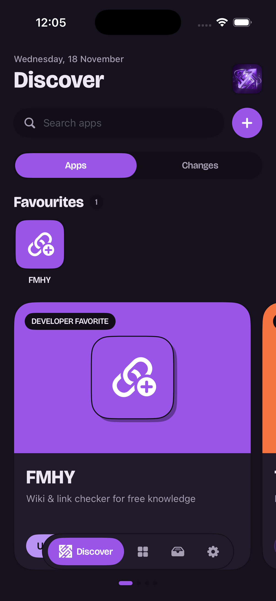
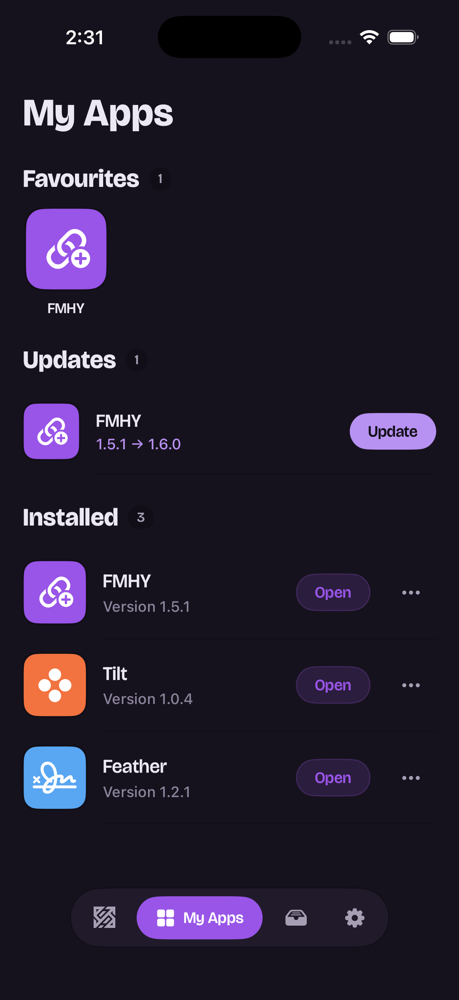
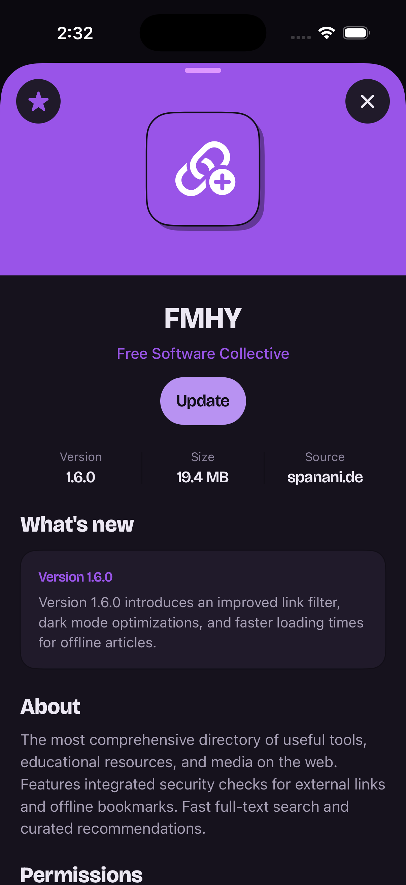
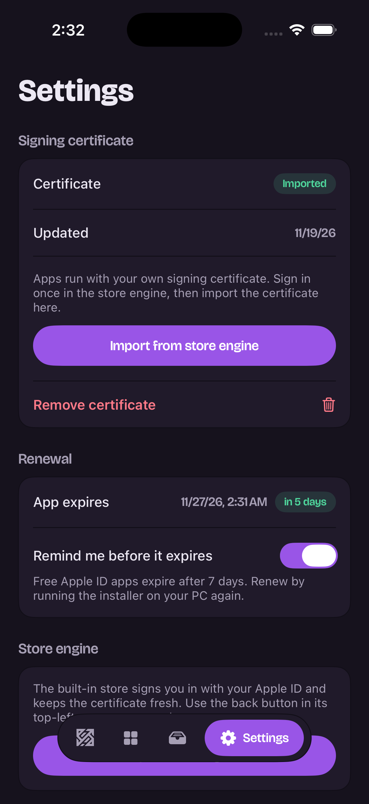

  
    
  <b>Your own app store for iPhone.</b> 
  A personal iPhone app store built on SideStore that installs and refreshes apps on-device with your free Apple ID.
    
  
  
  

## Highlights

<table>
<tr>
<td width="50%" valign="top">

- **On-device refresh**: LocalDevVPN loops traffic locally so apps refresh without a computer.
- **My Apps slot bar**: Expiry countdown, slot usage bar (up to 3 apps for free Apple IDs), and "Refresh All".
- **Background refresh**: Automatic background refresh toggle and notification reminders 24 hours before expiry.
- **IPA sideloading**: Install any `.ipa` from the Files app using the + button on Discover.
- **Home screen widget**: Shows remaining days (Settings displays "Widgets: Ready" or "Needs app group").

</td>
<td width="50%" valign="top">

- **Custom sources**: Add AltStore source JSON URLs to browse more apps.
- **Changes feed**: View latest versions and release notes across all sources.
- **Included app**: FMHY in default source (iOS reader for FMHY wiki by spanani.de, repo `spananide/fmhy-ios`).
- **Favourites**: Save favourite apps for quick access.
- **spanani interface**: Dark purple aesthetic, Bricolage Grotesque font, and 3D mark (English).
- **Windows installer**: One-click installer setup for Windows 10 and 11.

</td>
</tr>
</table>

## Screenshots

<table>
  <tr>
    <td></td>
    <td></td>
    <td></td>
    <td></td>
  </tr>
</table>

  

## Install

### Requirements
- iPhone with iOS 17 or newer
- Windows 10/11 PC for the installer (macOS/Linux builds of the upstream iloader exist but are not tested for spanani)
- iTunes from apple.com (not the Microsoft Store) for the Apple device driver
- Free Apple ID
- LocalDevVPN from the App Store

1. Download `spanani-installer-setup.exe` from the Releases page of https://github.com/spananide/spanani-installer and run it.
2. Plug in the iPhone, unlock, and tap Trust. Sign in with your Apple ID in the installer and click "Install spanani Store" (if Apple says the certificate limit is reached, choose which old certificate to revoke and continue).
3. On the iPhone: go to Settings > General > VPN & Device Management and trust your Apple ID; install LocalDevVPN from the App Store and turn it on; open spanani Store and sign in once.

## FAQ

Why a VPN?

LocalDevVPN loops traffic to the device itself so iOS accepts the install; nothing leaves the phone through it.

Is my Apple ID safe?

It is only sent to Apple; stored in the iOS Keychain.

Why 7 days?

Limit of free Apple IDs; enable auto-refresh and keep LocalDevVPN on.

Can I add other sources?

Yes. In the Sources tab, tap +.

Is this affiliated with Apple, SideStore or FMHY?

No. Not affiliated with, endorsed by or sponsored by Apple, SideStore, AltStore or FMHY.

## Build from source

Requires macOS with Xcode 15+ and Rustup.

- Run `make build fakesign ipa` to build `SideStore.ipa`.
- The GitHub Actions workflow `Build` builds and publishes a release on tags `v*`.
- UI lives in the Swift package `SpananiUI/`.
- Engine bridge is in `AltStore/SpananiBridge.swift`.
- `SpananiPreview/` renders screenshots in CI.

## Credits and licence

- Built on [SideStore](https://github.com/SideStore/SideStore) (AGPL-3.0), which is a fork of AltStore by Riley Testut.
- Uses `em_proxy`, `minimuxer`, and `LocalDevVPN`.
- Typography: Bricolage Grotesque (SIL OFL).
- Licence: AGPL-3.0, see [LICENSE](LICENSE). Source of the store UI is in this repo.

## Disclaimer

Not affiliated with, endorsed by or sponsored by Apple, SideStore, AltStore or FMHY. Sideloading is done with your own Apple ID at your own risk.
