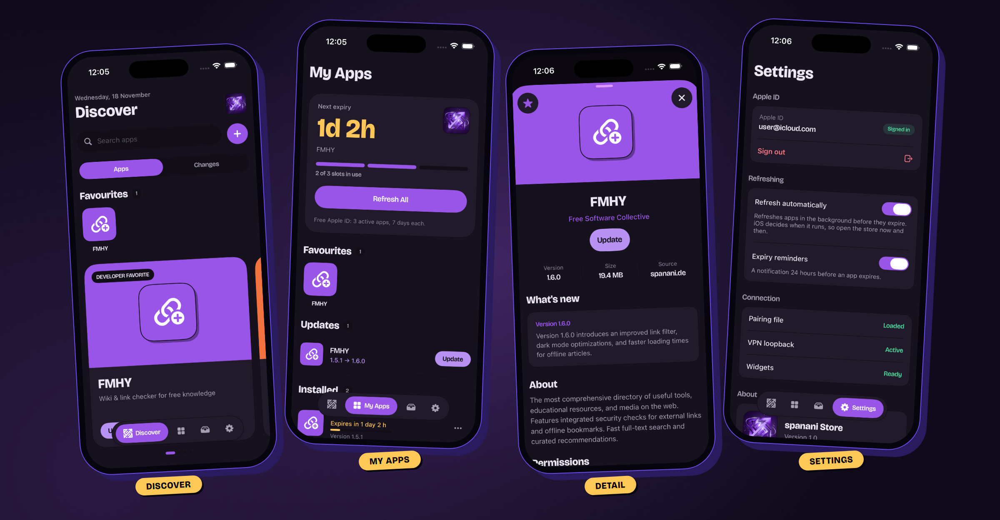
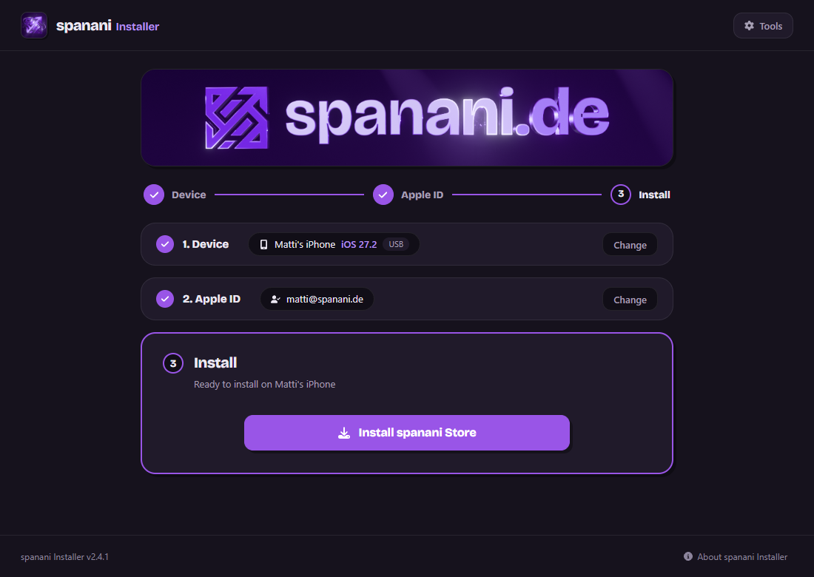

  
    
  <b>Your own app store for iPhone.</b> 
  A personal iPhone app store built on SideStore that installs and refreshes apps on-device with your free Apple ID.
    
  
  
  
  

  

## Highlights

**Keep apps alive**
- **On-device refresh**: LocalDevVPN loops traffic locally so apps refresh without a computer.
- **Slot management**: Expiry countdown, slot usage bar for up to 3 active apps, and a Refresh All button.
- **Background refresh**: Automatic background refresh toggle with reminders 24 hours before expiry.
- **Home screen widget**: Shows remaining days before certificate expiry.

**Find apps**
- **Custom sources**: Add AltStore source JSON URLs to browse community repositories.
- **IPA sideloading**: Install any `.ipa` directly from the Files app using the + button on Discover.
- **Changes feed**: View latest versions and release notes across all configured sources.
- **Included app**: FMHY reader included in default source (`spananide/fmhy-ios`).

**Make it yours**
- **Favourites**: Save favourite apps for quick access.
- **spanani interface**: Dark purple aesthetic with Bricolage Grotesque typography and 3D mark.
- **Windows installer**: One-click setup tool for Windows 10 and 11.

## Install

### Requirements
- iPhone with iOS 17 or newer
- Windows 10/11 PC for the installer (macOS/Linux builds of the upstream iloader exist but are not tested for spanani)
- iTunes from apple.com (not the Microsoft Store) for the Apple device driver
- Free Apple ID
- LocalDevVPN from the App Store

1. **Run the installer on your PC**  
   Download `spanani-installer-setup.exe` from the [spanani-installer Releases](https://github.com/spananide/spanani-installer/releases) page and run it.

2. **Connect iPhone and install**  
   Connect your iPhone, unlock it, and tap Trust. Sign in with your Apple ID in the installer and click "Install spanani Store" (revoke an old certificate if prompted).

3. **Trust profile and enable VPN on device**  
   On your iPhone, go to Settings > General > VPN & Device Management and trust your Apple ID certificate. Install LocalDevVPN from the App Store, turn it on, then open spanani Store and sign in.

  

## Community apps

Missing an app? Open **Discover**, scroll to the bottom and tap **Suggest an app**, then pick an `.ipa` from Files. Every file is checked by hand before it goes live. Accepted apps show up in Discover as Community apps. They are not made by spanani.de. Only send apps you are allowed to share; cracked or paid apps are declined.

## FAQ

Why a VPN?

LocalDevVPN loops traffic to the device itself so iOS accepts the install; nothing leaves the phone through it.

Is my Apple ID safe?

It is only sent to Apple; stored in the iOS Keychain.

Why 7 days?

Limit of free Apple IDs; enable auto-refresh and keep LocalDevVPN on.

Can I add other sources?

Yes. In the Sources tab, tap +.

Is this affiliated with Apple, SideStore or FMHY?

Not affiliated with, endorsed by or sponsored by Apple, SideStore, AltStore or FMHY.

## Build from source

Requires macOS with Xcode 15+ and Rustup.

- Run `make build fakesign ipa` to build `SideStore.ipa`.
- The GitHub Actions workflow `Build` builds and publishes a release on tags `v*`.
- UI lives in the Swift package `SpananiUI/`.
- Engine bridge is in `AltStore/SpananiBridge.swift`.
- `SpananiPreview/` renders screenshots in CI.

## Credits and licence

- Built on [SideStore](https://github.com/SideStore/SideStore) (AGPL-3.0), which is a fork of AltStore by Riley Testut.
- Uses `em_proxy`, `minimuxer`, and `LocalDevVPN`.
- Typography: Bricolage Grotesque (SIL OFL).
- Licence: AGPL-3.0, see [LICENSE](LICENSE). Source of the store UI is in this repo.

## Disclaimer

Not affiliated with, endorsed by or sponsored by Apple, SideStore, AltStore or FMHY. Sideloading is done with your own Apple ID at your own risk.
